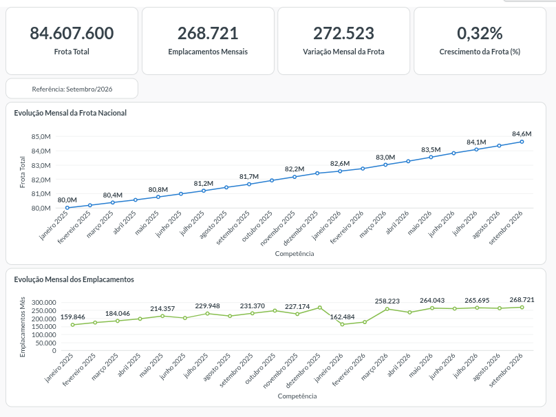
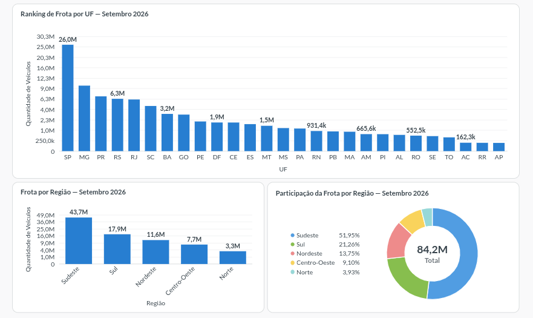
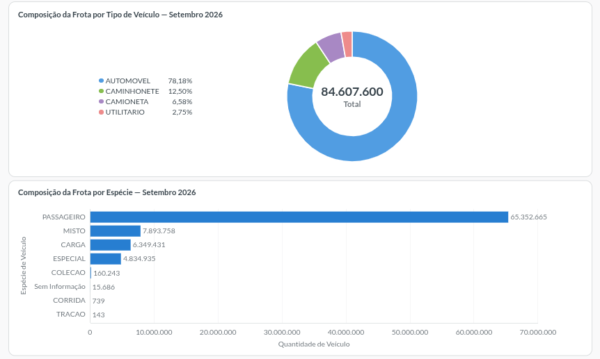
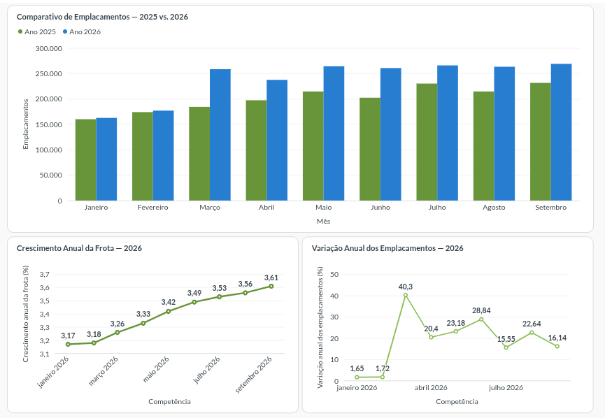

# Inteligência Comercial do Mercado Automotivo Brasileiro

Projeto de análise de dados que integra informações da frota de veículos e de emplacamentos no Brasil para construir uma visão comercial do mercado de automóveis e comerciais leves.

O trabalho percorre etapas de entendimento das fontes, inspeção e validação dos dados, modelagem dimensional em PostgreSQL, criação de consultas analíticas e desenvolvimento de dashboards no Metabase.

> **Escopo da versão atual:** competências de janeiro de 2025 a setembro de 2026. As análises de frota consideram automóveis, caminhonetes, camionetas e utilitários; as análises de emplacamentos utilizam a categoria consolidada **Autos + Com. Leves** da FENABRAVE.

## Objetivo de negócio

Construir uma base analítica que permita acompanhar o tamanho, a composição e a distribuição geográfica da frota brasileira, além de comparar a evolução do estoque de veículos com o fluxo mensal de emplacamentos.

O projeto busca responder perguntas como:

- Como a frota nacional evoluiu ao longo do período?
- Quais Unidades da Federação concentram a maior frota?
- Como a frota está distribuída entre as regiões brasileiras?
- Qual é a composição da frota por tipo e espécie de veículo?
- Como os emplacamentos evoluíram e como se comparam com o crescimento da frota?

## Fontes de dados

| Fonte | Conteúdo utilizado | Conceito analítico |
|---|---|---|
| [SENATRAN](https://www.gov.br/transportes/pt-br/assuntos/transito) | Dados mensais da frota por UF, município, marca/modelo, tipo, espécie e outros atributos disponíveis na fonte | **Estoque:** veículos registrados na data de referência |
| [FENABRAVE](https://fenabrave.org.br/) | Série mensal de emplacamentos e indicadores publicados para Autos + Com. Leves | **Fluxo:** veículos emplacados durante o período |

Os dados são tratados respeitando as características de cada fonte. Frota e emplacamentos representam conceitos diferentes: a variação do estoque da frota não equivale ao volume de emplacamentos.

## Tecnologias e ferramentas

- **PostgreSQL:** armazenamento, modelagem relacional e camada analítica.
- **SQL:** consultas, agregações, indicadores e views analíticas.
- **Python:** inspeção e validação de dados.
- **Pandas e NumPy:** manipulação e análise dos dados.
- **JupyterLab / Notebooks:** exploração e documentação das etapas de análise.
- **Metabase:** construção e publicação dos dashboards.
- **Git e GitHub:** versionamento e documentação do projeto.

O Power BI pode ser utilizado em uma evolução futura; os quatro dashboards descritos nesta versão foram construídos no Metabase.

## Arquitetura e modelagem

A solução utiliza PostgreSQL com separação entre dados de preparação e camada analítica. No schema `analytics`, o modelo dimensional mantém fatos independentes para estoque da frota e emplacamentos, relacionados às dimensões aplicáveis.

Principais componentes documentados:

- `fato_frota`: estoque de veículos por competência e atributos geográficos e veiculares.
- `fato_emplacamentos`: volumes e indicadores mensais publicados pela FENABRAVE.
- `dim_calendario`: competências e atributos temporais.
- `dim_uf`: Unidades da Federação e regiões.
- `dim_tipo_veiculo`: tipos de veículos.
- `dim_especie_veiculo`: espécies de veículos.

A camada analítica disponibiliza views agregadas para consumo nos dashboards. A modelagem mantém as duas tabelas fato separadas, evitando relacionamentos diretos entre fatos e preservando a distinção entre estoque e fluxo.

Documentação técnica:
- [Modelo dimensional](docs/arquitetura/modelo_dimensional.md)
- [Camada analítica e inventário de views](docs/arquitetura/camada_analitica.md)
- [Diagrama do modelo (Mermaid)](docs/arquitetura/diagrama_modelo.mmd)

## Dashboards

A versão atual contempla quatro dashboards no Metabase:

### 1. Visão Executiva

Apresenta os principais indicadores nacionais e a evolução mensal da frota e dos emplacamentos.



### 2. Inteligência Geográfica

Explora a distribuição da frota por Unidade da Federação e por região, incluindo ranking estadual e participação regional.



### 3. Perfil da Frota

Apresenta a composição da frota por tipo e espécie de veículo, com foco na participação de cada categoria.



### 4. Tendências de Mercado

Compara os emplacamentos de 2025 e 2026 por mês e apresenta indicadores de variação anual da frota e dos emplacamentos.



Os dashboards são atualizados conforme a disponibilidade das competências e a atualização das bases utilizadas no projeto.

## Indicadores e cuidados metodológicos

- **Frota total:** quantidade de veículos no estoque da competência.
- **Variação da frota:** mudança do estoque entre competências ou períodos comparáveis.
- **Emplacamentos mensais:** quantidade de veículos emplacados no período, conforme a fonte.
- **Participação por UF, região, tipo ou espécie:** proporção de cada grupo em relação ao total correspondente.
- **Variação anual:** comparação entre competências equivalentes, distinguindo o cálculo feito a partir da série histórica do percentual publicado pela FENABRAVE.

### Auditoria da série histórica FENABRAVE

Foi documentada uma diferença entre os volumes de 2025 presentes na série histórica e as referências de 2025 publicadas nos relatórios mensais de 2026. A auditoria identificou diferenças nos nove meses analisados, de janeiro a setembro.

A decisão metodológica foi preservar ambas as referências: utilizar a série histórica quando a análise exigir recálculo comparável entre competências e manter o percentual publicado quando o objetivo for reproduzir o indicador divulgado pela entidade. A divergência não foi atribuída a uma causa sem evidência suficiente.

Consulte [Auditoria das bases de comparação — FENABRAVE](docs/qualidade/auditoria_fenabrave.md).

## Qualidade e validação

O projeto inclui verificações de integridade, granularidade e consistência das tabelas e views analíticas, além de comparações entre agregações nacionais e recortes por UF, tipo e espécie.

As regras, resultados e limitações conhecidos estão registrados nos documentos técnicos e de qualidade. Valores sem base histórica de comparação são tratados como ausentes, e não como zero.

## Estrutura do repositório

```text
.
├── data/
│   ├── raw/
│   ├── processed/
│   └── exports/
├── docs/
│   ├── analises/
│   ├── arquitetura/
│   │   ├── camada_analitica.md
│   │   ├── diagrama_modelo.mmd
│   │   └── modelo_dimensional.md
│   ├── images/
│   │   ├── inteligencia-geografica.png
│   │   ├── perfil-da-frota.png
│   │   ├── tendencias-de-mercado.png
│   │   └── visao-executiva.png
│   └── qualidade/
│       └── auditoria_fenabrave.md
├── notebooks/
│   ├── 00_validacao_ambiente.ipynb
│   └── 01_ inspecao_dados_senatran.ipynb
├── src/
│   ├── extraction/
│   ├── loading/
│   └── transformation/
├── requirements.txt
└── README.md
```

Os diretórios de dados estão versionados como estrutura de projeto; os arquivos brutos não são incluídos neste repositório. Consulte as fontes oficiais para obter os dados originais.

## Como preparar o ambiente Python

Recomenda-se criar um ambiente virtual e instalar as dependências listadas em `requirements.txt`:

```bash
python -m venv .venv
source .venv/bin/activate
python -m pip install --upgrade pip
pip install -r requirements.txt
```

No Windows, a ativação do ambiente virtual pode ser feita com:

```powershell
.venv\Scripts\Activate.ps1
```

Os notebooks apoiam as etapas de inspeção e validação. A camada analítica descrita na documentação depende do banco PostgreSQL e das tabelas e views do projeto.

## Próximas evoluções

- Consolidar instruções de configuração e reprodução do banco e das consultas.
- Automatizar e documentar rotinas de extração, transformação e carga.
- Avaliar a ampliação do histórico e de novos recortes analíticos conforme a disponibilidade das fontes.

## Sobre o projeto

Projeto independente de portfólio, desenvolvido para demonstrar competências em análise de dados, SQL, PostgreSQL, modelagem dimensional, validação de dados e visualização de indicadores de negócio.

As conclusões devem ser interpretadas dentro do período, das categorias e das limitações metodológicas documentadas neste repositório.
